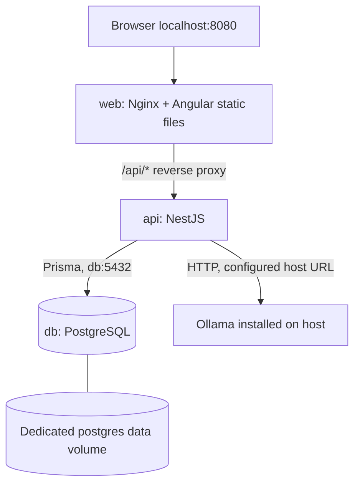

# Architecture — Release 0.1 (planned)

The goal is a tiny, local-first, single-user full-stack application. For the demo, **Angular (Nginx), NestJS and PostgreSQL run together in Docker Compose**. An existing Ollama installation runs separately on the host; Angular and NestJS can still run natively during development.



## Container boundaries

- One simple `compose.yaml` defines `web`, `api` and `db` and uses Compose's default service-name network; no custom network or orchestrator is needed.
- Publish **only the web entry point** to localhost by default. Nginx forwards `/api/*` to `api:3000` without dropping the `/api` prefix. Angular calls relative `/api` endpoints to avoid hardcoded container hostnames or browser CORS complexity.
- Database files persist in **one named PostgreSQL volume**, not in a shared volume mounted by all three services. Container-to-container database connections use `db:5432`. For a native backend dev process, document a separate localhost database URL if its port is published for development.
- The API calls host-installed Ollama at an environment-configured URL, typically `http://host.docker.internal:11434` when in Docker. On Linux, the API container may require `extra_hosts: ["host.docker.internal:host-gateway"]`. Ollama defaults to loopback listening, so host-to-container reachability must be checked; if its bind address is changed, **do not expose it publicly**.
- `docker compose up --build` should build/start all three application/database services. Make database readiness/migrations explicit and give user-friendly guidance if host Ollama is unavailable. No model download or AI container is required to start the website.
- `.env.example` contains non-secret demo defaults. Provider secrets never go into Angular build files or Git history.

## User flow

1. Create a `Task` with `title`, optional `description`, `days`, and `minutesPerDay`.
2. Generate a preview via NestJS. The model returns ordered subtask titles and minute estimates as JSON.
3. Validate the model output with Zod. The NestJS scheduling service assigns subtasks to days in order and rejects a proposal that exceeds the total time budget.
4. Edit titles and estimates in the Angular preview; the server validates and calculates the schedule again when saving.
5. Explicitly save the accepted plan. Only then insert `Subtask` rows.
6. Mark subtasks complete. Compute progress from saved rows, not from AI text.

One task has **at most one saved plan** in the MVP. Before saving, a preview can be regenerated or edited. A different plan after save means creating a new task; automatic rescheduling is intentionally excluded.

## Domain model

| Entity | Fields |
| --- | --- |
| `Task` | `id`, `title`, `description?`, `days`, `minutesPerDay`, `createdAt`, `updatedAt` |
| `Subtask` | `id`, `taskId`, `title`, `day`, `order`, `estimatedMinutes`, `completed` |

`Task` owns many `Subtask` rows. Deleting a task also deletes its subtasks. No `User`, `Project`, `Plan`, `Agent`, or `Conversation` tables.

## Planned REST endpoints

| Method | Route | Purpose |
| --- | --- | --- |
| `GET` | `/api/health` | API liveness |
| `GET` | `/api/tasks` | List tasks and progress |
| `POST` | `/api/tasks` | Create a task |
| `GET` | `/api/tasks/:id` | Read a task and its subtasks |
| `PATCH` | `/api/tasks/:id` | Edit task details; scheduling inputs are locked after a plan is saved |
| `DELETE` | `/api/tasks/:id` | Delete task and subtasks |
| `POST` | `/api/tasks/:id/plan-preview` | Call Ollama; return a validated, unsaved proposal |
| `POST` | `/api/tasks/:id/plan` | Validate, assign days, and save accepted subtasks in a transaction |
| `PATCH` | `/api/subtasks/:id` | Set `completed` |

The preview response contains editable `title`, `estimatedMinutes`, and server-assigned `day` fields. The save endpoint recomputes `day`; it must not trust browser-supplied day values.

## Rules and failure handling

- Bound inputs (for example, `days: 1–14`, `minutesPerDay: 15–240`, and `3–8` proposed subtasks); finalize exact bounds during implementation.
- Make model output schema-constrained and validate it again server-side.
- Schedule ordered subtasks deterministically and keep each day within its budget; reject an over-capacity plan with a user-friendly message rather than silently cutting work.
- Handle unavailable Ollama, timeout, invalid JSON, and failed validation with a clear UI error and manual retry.
- Keep API/database/Ollama connection settings in environment variables; distinguish container DNS addresses from localhost dev URLs. Use no hardcoded API keys and no hidden cloud fallback.
- Unit-test scheduling and AI parsing with fixed JSON fixtures; require only one small real-model smoke test.
- The Angular client calls NestJS only. All persistence, prompt construction, validation, and scheduling belong to the backend.

## Planned file layout

```text
apps/api/   # NestJS, Prisma schema/migrations, tests, API Dockerfile
apps/web/   # Angular standalone components, Signals, web Dockerfile
infra/      # Docker Compose and Nginx /api reverse-proxy configuration
docs/       # Architecture, one release, evidence, and future notes
```
