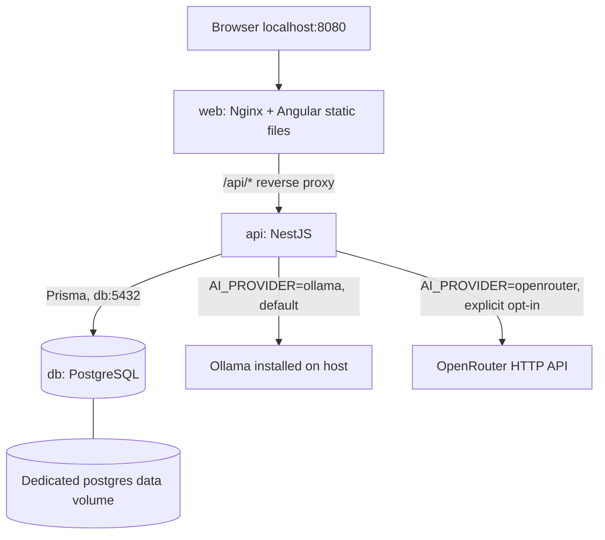

# Architecture — Releases 0.1 and 0.2

The goal is a tiny, local-first, single-user full-stack application. For the demo, **Angular (Nginx), NestJS and PostgreSQL run together in Docker Compose**. An existing Ollama installation runs separately on the host; Angular and NestJS can still run natively during development.

TFA-001–004 implement the local stack, the Task/Subtask schema and migration, task CRUD, the editable unsaved AI preview, explicit plan acceptance and persisted completion tracking.

TFA-005 adds an explicitly selected backend OpenRouter adapter. Ollama remains the default. TFA-006 adds bounded local model-call diagnostics. Both stories are locally verified; live-provider limits are recorded separately in release verification.



## Container boundaries

- One simple `compose.yaml` defines `web`, `api` and `db` and uses Compose's default service-name network; no custom network or orchestrator is needed.
- Publish **only the web entry point** to localhost by default. Nginx forwards `/api/*` to `api:3000` without dropping the `/api` prefix. Angular calls relative `/api` endpoints to avoid hardcoded container hostnames or browser CORS complexity.
- Database files persist in **one named PostgreSQL volume**, not in a shared volume mounted by all three services. Container-to-container database connections use `db:5432`. For a native backend dev process, document a separate localhost database URL if its port is published for development.
- The API calls host-installed Ollama at an environment-configured URL, typically `http://host.docker.internal:11434` when in Docker. On Linux, the API container may require `extra_hosts: ["host.docker.internal:host-gateway"]`. Ollama defaults to loopback listening, so host-to-container reachability must be checked; if its bind address is changed, **do not expose it publicly**.
- `docker compose up --build` should build/start all three application/database services. Make database readiness/migrations explicit and give user-friendly guidance if host Ollama is unavailable. No model download or AI container is required to start the website.
- `.env.example` contains non-secret demo defaults. Provider secrets never go into Angular build files or Git history.

## User flow

1. Create a `Task` with `title`, optional `description`, `days`, and `minutesPerDay`.
2. Generate a preview via NestJS. The model returns ordered subtask titles and minute estimates as JSON.
3. Validate the model output with Zod. The NestJS scheduling service assigns subtasks to days in order and rejects a proposal that exceeds the total time budget.
4. Edit titles and estimates in the Angular preview; the server validates and calculates the schedule again when saving.
5. Explicitly save the accepted plan. Only then insert `Subtask` rows.
6. Mark subtasks complete. Compute progress from saved rows, not from AI text.

One task has **at most one saved plan** in the MVP. Before saving, a preview can be regenerated or edited. A different plan after save means creating a new task; automatic rescheduling is intentionally excluded.

## Domain model

| Entity | Fields |
| --- | --- |
| `Task` | `id`, `title`, `description?`, `days`, `minutesPerDay`, `createdAt`, `updatedAt` |
| `Subtask` | `id`, `taskId`, `title`, `day`, `order`, `estimatedMinutes`, `completed` |

`Task` owns many `Subtask` rows. Deleting a task also deletes its subtasks. No `User`, `Project`, `Plan`, `Agent`, or `Conversation` tables.

## REST endpoints

Health, task CRUD, plan preview, plan save and completion routes are implemented. Task list/detail responses include `progress: { total, completed, percent }`, computed from saved rows. Percent is rounded to the nearest whole number and is 0 when there is no saved plan. The list omits subtask details; the detail response includes them in step order.

| Method | Route | Purpose |
| --- | --- | --- |
| `GET` | `/api/health` | API liveness |
| `GET` | `/api/tasks` | List tasks and progress |
| `POST` | `/api/tasks` | Create a task |
| `GET` | `/api/tasks/:id` | Read a task and its subtasks |
| `PATCH` | `/api/tasks/:id` | Edit task details; scheduling inputs are locked after a plan is saved |
| `DELETE` | `/api/tasks/:id` | Delete task and subtasks |
| `POST` | `/api/tasks/:id/plan-preview` | Call the selected provider; return a validated, unsaved proposal |
| `POST` | `/api/tasks/:id/plan` | Validate, assign days, and save accepted subtasks in a transaction |
| `PATCH` | `/api/subtasks/:id` | Set `completed` |

The preview response contains editable `title`, `estimatedMinutes`, and server-assigned `day` fields. The save endpoint recomputes `day`; it must not trust browser-supplied day values.

`POST /api/tasks/:id/plan-preview` takes an empty body and returns status 200 with `{ subtasks: [{ title, estimatedMinutes, day, order }] }`. Days start at 1 and order starts at 0. It reads the task's stored text/budget and rejects tasks with saved subtasks. It performs no database writes.

`POST /api/tasks/:id/plan` accepts only `{ subtasks: [{ title, estimatedMinutes }] }` and returns status 201 with the complete saved task and progress. Strict Zod validation rejects client-assigned `day`, `order`, IDs and completion flags before opening a write transaction. The transaction locks the task row with a parameterized PostgreSQL `FOR UPDATE`, reads its current budget and existing subtasks, schedules all accepted steps again and inserts them through one nested Prisma write. A second saved plan returns 409; invalid input returns 400 and a valid plan that cannot fit returns 422. Task budget updates take the same row lock, so a concurrent budget change cannot invalidate an accepted plan.

`PATCH /api/subtasks/:id` accepts only `{ completed: boolean }` and returns status 200 with the owning task, ordered subtasks and updated progress. It sets a value rather than inverting it, so repeating a request has the same completion result. Completion updates lock the parent task and update the step and task timestamp in one transaction. Missing tasks/steps return 404. No additional business entity, column or migration is required.

`PlanPreviewService` reads `AI_PROVIDER` at generation: omitted selects `ollama`, `openrouter` opts into the hosted adapter, and any other value fails clearly. Both adapters are injected directly; no provider framework or cloud fallback is involved. Validation is lazy, so health/task/persistence operations do not require model credentials. `planMessages()` owns the shared prompt and escaped task data. `OllamaService` makes one non-streaming `/api/chat` request; `OpenRouterService` makes one authenticated `/chat/completions` request with strict JSON Schema, required parameter support and provider fallbacks disabled. The OpenRouter adapter also rejects redirects, refusals, incomplete completions, and error envelopes returned with HTTP 200. Credentials and raw provider failures stay out of API errors and logs.

TFA-006 adds one bounded `ai_plan_call` JSON outcome event in `PlanPreviewService` for each selected provider attempt, including configuration/validation/scheduling failures. The thin preview controller generates a fresh UUID, returns it in `X-Request-ID`, and passes it to the service; no caller ID is trusted or sent to the model. The event includes only that UUID, provider, a bounded safe configured model identifier, monotonic duration, outcome, a fixed error category and any valid reported token counts. The provider adapters report numeric usage separately from the unchanged subtask return value, so failed proposals can retain known usage without logging their content. Missing/invalid usage is omitted and no totals or costs are inferred. Pre-provider HTTP/task/selection rejections emit no model event. API bodies, scheduling, persistence, Angular and Compose remain unchanged. This is local call diagnostics, not distributed tracing or a hosted telemetry integration.

Each adapter has its own 1–120-second timeout covering the full response, uses the shared 64 KiB bounded reader and validates the nested proposal with the same strict Zod schema. The request's per-step maximum matches the task's daily minutes; returned estimates are still checked and scheduled server-side. `schedulePlan()` fills days in order without splitting or reordering steps, and rejects packing overflow even when an arithmetic total might fit. Angular's task API service remains its only HTTP boundary; it recognizes the fixed AI error codes while keeping unknown server failures generic. The preview component owns transient Signals/forms and cancels its HTTP subscription when its view closes.

Angular presents an inline save confirmation before contacting the persistence endpoint. The response replaces the preview with a saved daily plan and updates list/detail progress. Navigation and conflicting edits are disabled during writes. Completion checkboxes keep their previous value until a successful response; failed writes show a retryable error without replacing the draft or recorded progress. Saved task budget fields are disabled while title/description editing remains available.

## Rules and failure handling

- Task inputs are validated with strict Zod schemas: a trimmed 1–160-character title, optional/null description up to 2000 characters, integer `days: 1–14`, and integer `minutesPerDay: 15–240`. Unknown fields and empty updates return 400. Malformed UUIDs return 400; missing tasks return 404. Scheduling values cannot change if saved subtasks already exist. AI proposals require 3–8 steps, trimmed 1–160-character titles, and integer estimates from 1 to 240 minutes; a step must additionally fit the task's daily limit.
- Make model output schema-constrained and validate it again server-side.
- Schedule ordered subtasks deterministically and keep each day within its budget; reject an over-capacity plan with a user-friendly message rather than silently cutting work.
- Handle unavailable Ollama, timeout, invalid JSON, and failed validation with a clear UI error and manual retry.
- Preview errors use safe codes/messages: `AI_PROVIDER_NOT_CONFIGURED`, `OLLAMA_NOT_CONFIGURED`, `OLLAMA_UNAVAILABLE`, `OPENROUTER_NOT_CONFIGURED`, `OPENROUTER_ACCESS_DENIED`, `OPENROUTER_CREDITS_REQUIRED`, `OPENROUTER_MODEL_UNSUPPORTED`, `OPENROUTER_RATE_LIMITED`, and `OPENROUTER_UNAVAILABLE` (503); `OLLAMA_TIMEOUT` and `OPENROUTER_TIMEOUT` (504); `INVALID_AI_OUTPUT` (502); and `PLAN_EXCEEDS_BUDGET` (422). Raw provider text is not exposed and partial/extra-field proposals are rejected. There is no automatic repair or fallback. A hosted call occurs only with explicit OpenRouter selection and a generation request.
- Keep API/database/Ollama connection settings in environment variables; distinguish container DNS addresses from localhost dev URLs. Use no hardcoded API keys and no hidden cloud fallback.
- Unit-test scheduling and AI parsing with fixed JSON fixtures. Real-provider checks need explicit approval; hosted checks also need credentials and approval for the billable request.
- The Angular client calls NestJS only. All persistence, prompt construction, validation, and scheduling belong to the backend.

## File layout

```text
apps/api/   # NestJS, Prisma schema/migrations, tests, API Dockerfile
apps/web/   # Angular standalone components, Signals, web Dockerfile
infra/      # Docker Compose and Nginx /api reverse-proxy configuration
docs/       # Architecture, release maps, evidence, and future notes
```
